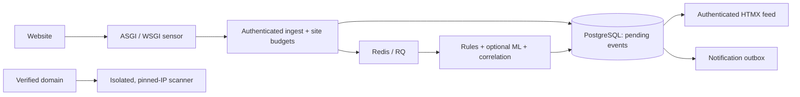

# Detexis Shield

A monitor-only website security sensor, detection backend and authenticated HTMX
dashboard. The Python SDK supports FastAPI/Starlette and Flask, redacts named
sensitive query parameters, hashes IPs per site/day, and sends bounded batches in
the background. It never blocks a website request on a detection decision.



## Run and test

Use Python 3.12. From this directory:

```sh
python -m pip install -r requirements-dev.txt -e sensor-sdk
python -m pytest -q -p no:cacheprovider
docker compose up --build -d
docker compose exec api python create_site.py demo.local
```

Save the printed API key and site salt. See [DEPLOYMENT.md](DEPLOYMENT.md) for
local setup, workers, TLS, alerts, ownership verification and deployment.
The existing app at https://detexis.vercel.app/ remains the separate legacy app.

## Implemented

- Site-key authentication, hashed secrets, tenant-scoped event idempotency,
  bounded ingest bodies, atomic Redis request/event budgets and Alembic migrations.
- ASGI/WSGI sensors with bounded buffers, retries/backoff, validated configuration
  refresh, heartbeat, redaction and [shared URL features](FEATURES.md).
- RQ processing with durable pending-row recovery, 12 heuristic rules, CWE/OWASP
  tags, and three positive/three negative cases per rule.
- Incident grouping, recon-to-exploit/repeated-failure/flood correlations,
  seven-day same-hour baselines, notification outbox and retention maintenance.
- Authenticated, escaped HTMX event/incident feed and site-isolation tests.
- Verified-domain scanner with pinned public IPs, redirect checks, time/size caps,
  TLS/header/session-cookie/file/DNS-policy checks and isolated-container setup.
- ML training/evaluation tooling for logistic regression or XGBoost, chronological
  session separation, independent-dataset evaluation, FPR confidence bounds,
  artifact schema/version checks, optional SHAP reasons and rule fallback.
  **No real-data model or production FPR result is bundled.**

## Evidence and limits

[STATUS.md](STATUS.md) separates implemented code from live acceptance evidence.
Unit tests do not establish production throughput, scanner isolation on a host,
notification delivery, real classifier performance or a real-site monitoring count.

The SDK targets persistent Python workers; it is not a validated Vercel-function
sensor. It records URL-derived features, not request bodies. Keys currently grant
both telemetry and dashboard access for their site; user accounts and finer scopes
are future work. A canary/scanner hit is a signal needing review, not proof of an
attacker. Daily IP hashes do not establish account identity or credential stuffing.

Read the [threat model](THREAT-MODEL.md), [retry contract](RETRIES.md),
[ML data/evaluation requirements](ml/README.md) and [demo runbook](DEMO.md).
